# Диаграмма классов доменной модели (Class Diagram)

## Описание
Диаграмма отражает сущности предметной области (Entities), интерфейсы репозиториев (Repository Interfaces) и сценарии использования (Use Cases) в соответствии с принципами Clean Architecture. Доменный слой изолирован от внешних фреймворков и БД.

```mermaid
classDiagram
    direction TB

    class Habit {
        +String id
        +String title
        +String description
        +HabitSchedule schedule
        +DateTime createdAt
        +bool isArchived
        +int targetPerDay
        +String? reminderTime
        +int monthlyFreezesAllowed
    }

    class HabitSchedule {
        +ScheduleType type
        +List~int~ daysOfWeek
        +bool isScheduledFor(DateTime date)
    }

    class ScheduleType {
        <<enumeration>>
        EVERY_DAY
        SPECIFIC_DAYS
    }

    class HabitCompletion {
        +String id
        +String habitId
        +DateTime date
        +bool isFrozen
        +DateTime recordedAt
    }

    class StreakInfo {
        +int currentStreak
        +int longestStreak
        +int freezesUsedThisMonth
        +int freezesRemaining
        +DateTime? lastCompletedDate
    }

    class StabilityMetrics {
        +double stabilityRate30Days
        +int totalScheduledDays
        +int completedDays
        +int frozenDays
        +int missedDays
    }

    class FreezePolicy {
        +int monthlyAllowance
        +bool canFreeze(int usedThisMonth)
        +int remainingAfter(int usedThisMonth)
        +String monthKey(DateTime date)$
        +DateTime normalize(DateTime date)$
    }

    class ApplyAutoFreezeUseCase {
        +CompletionRepository completionRepository
        +Clock clock
        +Future~AutoFreezeResult~ execute(Habit, List~HabitCompletion~, DateTime currentDate)
    }

    class AutoFreezeResult {
        +List~HabitCompletion~ createdFreezes
        +List~HabitCompletion~ allCompletions
        +bool hasNewFreezes
    }

    class ReminderTime {
        +int hour
        +int minute
        +ReminderTime? tryParse(String raw)$
        +String value
        +int minutesSinceMidnight
    }

    class ReminderScheduler {
        <<interface>>
        +Future~void~ initialize()
        +Future~bool~ requestPermissions()
        +Future~void~ syncHabitReminder(Habit habit)
        +Future~void~ cancelHabitReminder(String habitId)
        +Future~void~ syncAll(List~Habit~ habits)
        +Stream~String~ habitTapStream
        +String? consumeInitialPayload()
    }

    class HabitRepository {
        <<interface>>
        +Future~List~Habit~~ getAllHabits()
        +Future~Habit?~ getHabitById(String id)
        +Future~void~ saveHabit(Habit habit)
        +Future~void~ deleteHabit(String id)
    }

    class CompletionRepository {
        <<interface>>
        +Future~List~HabitCompletion~~ getCompletionsForHabit(String habitId)
        +Future~List~HabitCompletion~~ getCompletionsByDateRange(String habitId, DateTime from, DateTime to)
        +Future~void~ addCompletion(HabitCompletion completion)
        +Future~void~ removeCompletion(String habitId, DateTime date)
    }

    class CalculateStreakUseCase {
        +Clock clock
        +StreakInfo execute(Habit habit, List~HabitCompletion~ completions, DateTime currentDate)
    }

    class CalculateStabilityIndexUseCase {
        +Clock clock
        +StabilityMetrics execute(Habit habit, List~HabitCompletion~ completions, DateTime currentDate)
    }

    class ToggleCompletionUseCase {
        +CompletionRepository completionRepo
        +Clock clock
        +Future~void~ toggle(String habitId, DateTime date)
    }

    Habit *-- HabitSchedule
    HabitSchedule *-- ScheduleType
    Habit "1" --> "*" HabitCompletion : has history
    CalculateStreakUseCase ..> Habit : uses
    CalculateStreakUseCase ..> HabitCompletion : uses
    CalculateStreakUseCase ..> StreakInfo : produces
    CalculateStabilityIndexUseCase ..> Habit : uses
    CalculateStabilityIndexUseCase ..> HabitCompletion : uses
    CalculateStabilityIndexUseCase ..> StabilityMetrics : produces
    ToggleCompletionUseCase ..> CompletionRepository : invokes
    ApplyAutoFreezeUseCase ..> FreezePolicy : applies
    ApplyAutoFreezeUseCase ..> CompletionRepository : writes freezes
    ApplyAutoFreezeUseCase ..> AutoFreezeResult : produces
    ReminderScheduler ..> Habit : schedules
    ReminderScheduler ..> ReminderTime : parses
```

## Пояснения к классам:
- `Habit`: ключевая сущность привычки со свойствами периодичности и лимитом доступных заморозок.
- `HabitCompletion`: запись о событии дня (выполнено либо автоматически заморожено `isFrozen: true`).
- `StreakInfo`: объект-значение с расчетной текущей/рекордной серией и остатком заморозок на текущий месяц.
- `StabilityMetrics`: метрика стабильности за 30 дней, отражающая реальную дисциплину без обнуления из-за единичного сбоя.
- `FreezePolicy`: value object с месячным лимитом заморозок; не знает о БД и UI.
- `ApplyAutoFreezeUseCase`: материализует заморозки пропущенных дней; идемпотентен и останавливается при исчерпании квоты.
- `ReminderTime`: время `HH:mm` без зависимости от Flutter; парсится и тестируется отдельно.
- `ReminderScheduler`: контракт планировщика; реализация (`LocalReminderScheduler`) находится в слое `data`.
- `Clock`: абстракция времени, внедряемая в Use Cases для полной детерминированности тестов.
