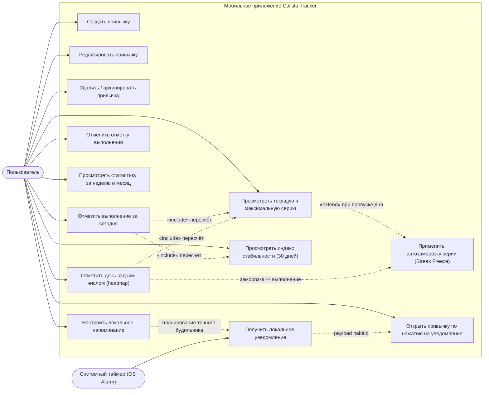

# Диаграмма прецедентов (Use Case Diagram)

## Описание
Диаграмма отражает функциональные возможности приложения Calista Tracker с точки зрения пользователя и системного планировщика напоминаний.

## Инструкция по экспорту и рендерингу диаграммы
1. **Онлайн:** скопируйте блок кода `mermaid` и вставьте на сайте [https://mermaid.live](https://mermaid.live) для мгновенного просмотра и скачивания в PNG/SVG.
2. **В VS Code / Android Studio:** установите расширение *Markdown Preview Mermaid Support* для интерактивного рендеринга прямо в IDE.
3. **На GitHub:** код диаграммы автоматически визуализируется встроенным движком GitHub при открытии данного файла в веб-интерфейсе.
